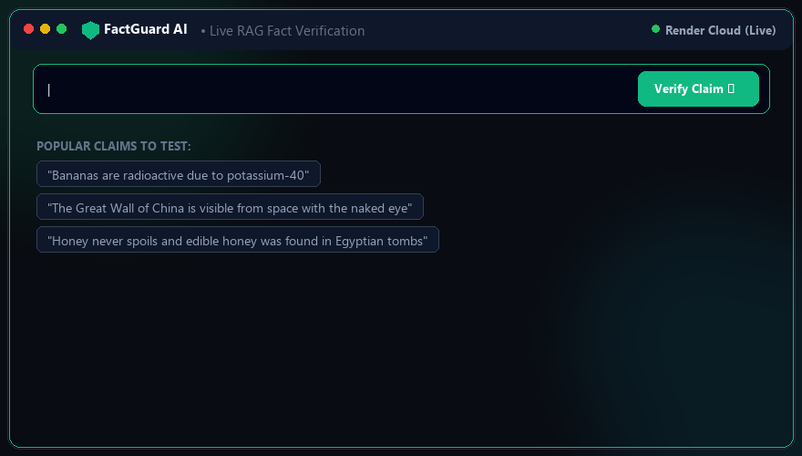

<div align="center">

# FactGuard AI: Real-Time Web Intelligence & Fact Verification

[](https://www.python.org/)
[](https://fastapi.tiangolo.com/)
[](https://nextjs.org/)
[](https://pypi.org/project/factguard/)
[](https://ollama.com)
[](https://factguard-1gge.onrender.com/)
[](https://opensource.org/licenses/MIT)

**An open-source, real-time fact-checking system that verifies arbitrary claims against live web intelligence (DuckDuckGo + Wikipedia), re-ranks evidence with BM25Okapi relevance scoring, and generates verifiable verdicts using LLM reasoning.**

🌐 **[Live Demo: factguard-1gge.onrender.com](https://factguard-1gge.onrender.com/)**

<p align="center">
  
</p>

[Features](#-key-features) • [Quick Start](#-quick-start) • [CLI Tool](#-cli-fact-checker) • [Python SDK](#-option-d-python-sdk-factguard) • [Chrome Extension](#-option-e-chrome-browser-extension) • [Scope & Limitations](#️-system-scope--honest-limitations)

</div>

---

## 🎯 Project Motivation

Information moves faster than human verification pipelines can keep up. Most automated fact-checking systems rely on **static databases** or pre-scraped knowledge graphs that quickly become obsolete. 

**FactGuard AI** explores a **live Retrieval-Augmented Generation (RAG)** approach: when presented with a claim, the system dynamically queries the open web (Wikipedia + DuckDuckGo), re-ranks the most contextually relevant snippets using high-speed BM25Okapi with phrase matching, and prompts an LLM with strict few-shot verification guidelines to synthesize an objective verdict with transparent source citations.

---

## ✨ Key Features

- **🌐 Live Internet Intelligence**: Queries DuckDuckGo and Wikipedia concurrently on the fly. No stale static databases.
- **⚡ Real-Time SSE Event Streaming**: Live progress transitions (`Claim Parsing` $\rightarrow$ `Live Search` $\rightarrow$ `BM25 Re-Ranking` $\rightarrow$ `LLM Verification`) streamed directly over Server-Sent Events with transparent telemetry.
- **🦙 100% Local Offline AI (Ollama)**: Full support for local models (`gemma4:e2b`, `llama3.2`, `qwen2.5`, `mistral`) running on `http://localhost:11434` or custom endpoints with zero cloud keys.
- **🔗 Shareable Verdict Permalinks**: One-click social sharing to Twitter/X, Reddit, LinkedIn, and Markdown badges with dynamic server-rendered OpenGraph cards (`/v/:id`).
- **🧩 Chrome Extension Companion**: Highlight any text on the web $\rightarrow$ right-click *"Verify with FactGuard"* $\rightarrow$ instant popup verdict and live citations.
- **📦 Python SDK (`factguard`)**: Modular 3-line Python package (`from factguard import FactGuard`) for integrating fact-checking into RAG pipelines and LangChain agents.
- **🔑 Bring Your Own Key (BYOK) Engine**: Plug in custom API keys for **Groq**, **Google Gemini**, **OpenAI**, or **Anthropic Claude** directly from the UI, or fallback seamlessly to the system's default key.
- **🔒 Zero-Storage Client Privacy**: Custom keys are stored only in the browser's `localStorage` (`factguard_llm_config`) and transmitted via headers per-request—never stored on server disk or database.
- **🔗 Direct Source Citations**: Every piece of evidence includes publisher badges (`Wikipedia`, `DuckDuckGo`) and direct clickable external links (`Read Source Article ↗`).
- **⚡ High-Precision BM25Okapi Re-Ranking**: Algorithmic relevance scoring with bi-gram phrase matching to prioritize the top context passages with sub-millisecond latency and zero memory overhead.
- **🤖 Multi-Provider LLM Reasoning**: Fast verification reasoning powered by native Groq execution or `litellm` (OpenAI, Gemini, Claude, Ollama) with structured JSON output validation.
- **⚡ In-Memory & Disk LRU Cache**: Instant (`0.00s`) responses for recurring claims with per-user isolation and auto-disk persistence.
- **📊 Real-Time Analytics Dashboard**: Live system monitoring featuring response time trendlines, verdict distributions, and confidence histograms.
- **💻 CLI Tooling**: Standalone command-line interface (`backend/cli.py`) for headless terminal verification and scripting.
- **🐳 Production Ready**: Fully Dockerized single-service multi-stage container with zero runtime Node.js overhead.

---

## 🚀 Quick Start

### 🌐 Live Cloud Demo
Test the live application directly in your browser without local installation:  
👉 **[https://factguard-1gge.onrender.com/](https://factguard-1gge.onrender.com/)**

### Option A: Docker Compose (Local)

The easiest way to run the entire stack locally with all dependencies pre-configured:

```bash
# 1. Clone the repository
git clone https://github.com/santoshkkashyap25/live-rag-fact-checker.git
cd live-rag-fact-checker

# 2. Configure your Groq API key in backend/.env
cp backend/.env.example backend/.env
# Edit backend/.env and set GROQ_API_KEY=gsk_...

# 3. Build and launch containers
docker compose up -d --build
```

- **Full-Stack Application**: [http://localhost:8000](http://localhost:8000)
- **Interactive Swagger Docs**: [http://localhost:8000/docs](http://localhost:8000/docs)
- **Health Check Endpoint**: [http://localhost:8000/health](http://localhost:8000/health)

To view container logs or stop services:
```bash
# Stream live logs
docker compose logs -f

# Stop and clean up containers
docker compose down
```

---

### Option B: Bare-Metal Setup

#### 1. Backend Setup

Prerequisites: **Python 3.11+**

```bash
# Navigate to backend directory
cd backend

# Create and activate virtual environment
python -m venv .venv
# On Windows:
.\.venv\Scripts\activate
# On Linux/macOS:
source .venv/bin/activate

# Install dependencies (CPU PyTorch recommended)
pip install torch --index-url https://download.pytorch.org/whl/cpu
pip install -r requirements.txt

# Configure environment
cp .env.example .env
# Edit .env and enter your GROQ_API_KEY

# Start backend server
python main.py
```
> The API will be available at `http://127.0.0.1:8000`.

#### 2. Frontend Setup

Prerequisites: **Node.js 20+** and **npm**

```bash
# Open a new terminal and navigate to frontend directory
cd frontend

# Install Node dependencies
npm install

# Start Next.js development server
npm run dev
```
> The web interface will be available at `http://localhost:3000`.

---

### Option C: CLI Fact-Checker

You can verify statements directly in your command line without starting the web UI:

```bash
# From project root (with virtualenv activated):
python backend/cli.py "Bananas are naturally radioactive due to potassium-40."
```

---

### Option D: Python SDK (`factguard`)

Use FactGuard directly in your Python code, LangChain agents, or automated evaluation pipelines:

```python
from factguard import FactGuard

fg = FactGuard()  # Connects to live cloud or local server
result = fg.verify("The Digital India initiative was launched in 2015.")

print(result.verdict)       # True
print(result.confidence)    # 0.95
print(result.reasoning)     # Detailed rationale with citations
```

---

### Option E: Chrome Browser Extension

Verify claims anywhere on the web by highlighting text:

1. Open `chrome://extensions` (or `brave://extensions` / `edge://extensions`).
2. Toggle **Developer mode** $\rightarrow$ Click **"Load unpacked"**.
3. Select the `extension/` directory from this repository.
4. Highlight any text on Twitter, Reddit, or news sites $\rightarrow$ right-click **"Verify with FactGuard"**!

---

## 🛡️ System Scope & Honest Limitations

> **Fact-checking automated with AI is a research assistant, not an absolute arbiter of truth.**

FactGuard AI is designed around transparency and verifiable grounding rather than ungrounded generative authority.

### What FactGuard AI Does Well
- **Fast Web Grounding**: Retrieves current, open-web facts in ~3–5 seconds without maintaining a costly or stale vector database.
- **Auditable Evidence**: Every claim verdict includes direct publisher source pills, relevancy scores, and clickable reference URLs so human users can audit the original reporting.
- **Atomic Claim Extraction**: Isolates key verifiable assertions from compound or convoluted conversational statements using SpaCy dependency parsing.
- **Strict Rationale**: Guided few-shot LLM prompts minimize ungrounded hallucinations by requiring explicit evidence corroboration.

### Boundaries & Known Limitations
- **Consensus & Search Quality**: Verdicts reflect the consensus and quality of top search results. If credible sources are absent or unindexed, the system marks claims as *Unverifiable*.
- **Not a Substitute for Human Investigation**: Complex historical debates, emerging breaking crises, nuanced political speeches, and medical decisions require domain-expert human scrutiny.
- **Public API Rate Limits**: Real-time web retrieval relies on public DuckDuckGo and Wikipedia REST interfaces. High-volume unthrottled queries may be subject to temporary IP rate limits.
- **Satire & Sarcasm Sensitivity**: Deeply sarcastic statements or satirical publications (e.g., *The Onion*) may occasionally fool semantic retrievers if context is ambiguous.
- **Always Audit Sources**: While low temperature (`0.2`) and strict output schemas reduce errors, LLMs can occasionally misinterpret complex propositions. Always click through to the provided source URLs.

---

## 🤝 Contributing

Contributions are warmly welcomed! To contribute:

1. **Fork** the repository.
2. Create a feature branch: `git checkout -b feature/amazing-feature`.
3. Commit your changes: `git commit -m 'Add amazing feature'`.
4. Push to the branch: `git push origin feature/amazing-feature`.
5. Open a **Pull Request**.

Please ensure new code adheres to existing formatting standards and includes appropriate tests.

---

## 📄 License

This project is distributed under the **MIT License**. See the [LICENSE](./LICENSE) file for complete details.
