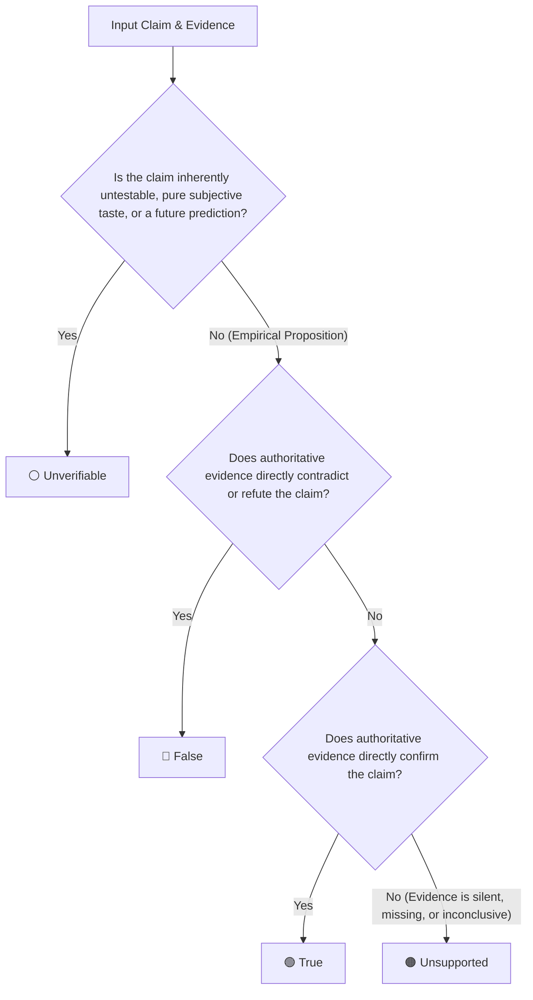

# FactGuard AI: Epistemic Labeling Policy (4-Class Taxonomy)

This document establishes the formal, unambiguous standard for classifying factual propositions in FactGuard AI.

---

## 1. The 4-Class Taxonomy

| Label | Definition | Standard of Proof | User Guidance |
| :--- | :--- | :--- | :--- |
| **`True`** | The core factual assertion is confirmed by authoritative documentation. | Explicit, verifiable confirmation from peer-reviewed literature, official records, or recognized encyclopedic consensus. Normal variance in minor numerical tolerances (e.g. 400 vs 450 mg) does not invalidate the truth of the underlying fact. | *"This claim is supported by authoritative evidence."* |
| **`False`** | The core factual assertion is contradicted, refuted, or debunked by established facts. | Direct contradiction by physical laws, documented historical records, or published negative findings from scientific/investigative bodies. Includes known historical hoaxes, debunked conspiracy theories, and misattributed quotes. | *"This claim is contradicted or refuted by evidence."* |
| **`Unsupported`** | The claim asserts an empirical or historical fact, but available authoritative sources provide no confirmation, insufficient documentation, or remain silent. | Absence of positive evidence in reliable corpora. Absence of evidence is **not** treated as refutation unless an authoritative agency conducted an exhaustive audit and published a formal negative finding. | *"No credible sources confirm this assertion; evidence is missing or insufficient."* |
| **`Unverifiable`** | The claim cannot be resolved empirically because it is non-falsifiable in principle. | Includes: (1) purely subjective personal taste, aesthetics, or ethical opinions disguised as facts; (2) speculative future predictions that cannot be established prior to their occurrence; (3) inherently metaphysical propositions. | *"This statement is subjective, speculative, or fundamentally untestable."* |

---

## 2. Decision Logic & Boundary Guidelines

### Specific Boundary Rules:

1. **Unproven Scientific Hypotheses & Rumors**:
   - Claims asserting the affirmative existence of unconfirmed phenomena (e.g., *"Extraterrestrial life thrives on Europa"*, *"Planet Nine exists at 400 AU"*, *"A Type II civilization operates in Andromeda"*) MUST be classified as **`Unsupported`**, NOT `False` and NOT `Unverifiable`.
   - Reason: These are empirical, falsifiable propositions. They are not non-falsifiable opinions (`Unverifiable`), nor are they physically disproven (`False`); they simply lack empirical confirmation.

2. **Extraordinary Assertions & Hoaxes**:
   - If an investigative, medical, or scientific body has formally audited an affirmative assertion and published explicit counter-evidence (e.g., *"COVID vaccines contain microchips"*, *"NASA staged the Apollo 11 moon landing"*), classify as **`False`**.
   - If an obscure rumor has no documented coverage whatsoever, classify as **`Unsupported`**.

3. **Future Speculative Predictions**:
   - Claims asserting definitive future outcomes (e.g., *"Universal blood substitutes will replace donor blood by 2040"*, *"Quantum computers will solve NP-complete problems by 2038"*) MUST be classified as **`Unverifiable`** (or `Unsupported` if phrased as a current empirical commitment), NOT `False`. Lack of present realization does not refute future possibilities.

4. **Universal Quantifiers**:
   - If a claim asserts an absolute universal ("All", "Every", "Never", "Exclusively") and standard scientific consensus documents established counter-examples, it is **`False`** (e.g., *"All mammals give birth to live young"* is refuted by monotremes).

---

## 3. Benchmark Mapping (FEVER / SciFact)

When evaluating against 3-class academic datasets:
* `SUPPORTS` $\rightarrow$ `True`
* `REFUTES` $\rightarrow$ `False`
* `NOT ENOUGH INFO (NEI)` $\rightarrow$ Hierarchical union of `Unsupported` and `Unverifiable`:
  $$\text{NEI} = \{\text{Unsupported}, \text{Unverifiable}\}$$
